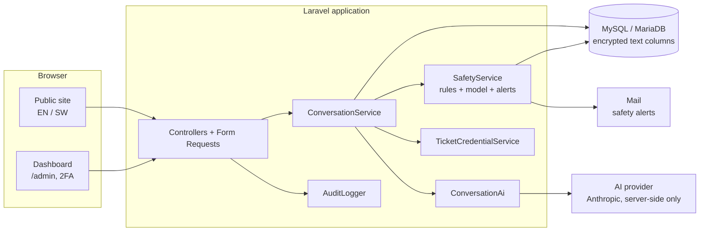
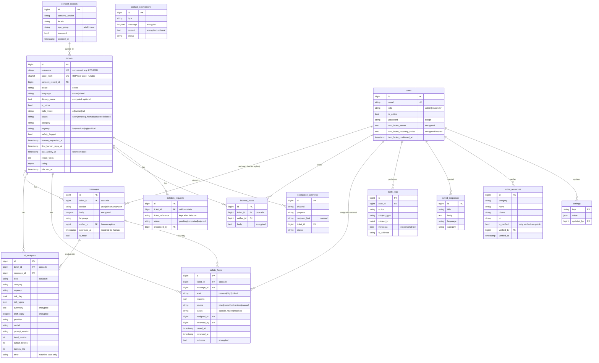

# Architecture

One Laravel application serves the public website and the private dashboard from the same backend and database. The same JSON-capable backend can later serve mobile apps (Phase 3) without a rebuild.



## Layers

| Layer | Location | Responsibility |
|---|---|---|
| Routes | `routes/web.php` | Public routes, `ticket` group (needs session access), `/admin` group (auth + 2FA + idle timeout + roles) |
| Middleware | `app/Http/Middleware` | `SetLocale`, `SecurityHeaders` (CSP, no-store), `EnsureLaunchReady`, `RequireTicketAccess`, `AdminSession` |
| Validation | `app/Http/Requests` | `UserMessageRequest`, `ConsentRequest`, `ChooseHelpRequest`, `ContactRequest`, `Admin/SendReplyRequest` |
| Controllers | `app/Http/Controllers`, `.../Admin` | Thin HTTP handling only |
| Services | `app/Services` | Business logic (below) |
| AI | `app/Services/Ai` | `AiProvider` interface, `AnthropicProvider`, `MockProvider`, `Prompts`, `ConversationAi`, `KnowledgeBase` (reference notes in `resources/knowledge`) |
| Safety | `app/Services/Safety` | `RuleBasedSafetyClassifier`, `SafetyAssessment`, `SafetyService`, `SafetyNotifier` |
| Models | `app/Models` | Eloquent models with `encrypted` casts for personal text |
| Views | `resources/views` | `layouts/`, `public/`, `admin/`, `components/` |
| Translations | `lang/en`, `lang/sw` | All public wording; Kiswahili marked for native review |
| Front end | `resources/js`, `resources/css/app.css` | Alpine CSP components, design tokens |

## Key services

- **ConversationService**: start a conversation after consent, handle each user message, run the safety rules first, then the AI turn, record the choice of help, issue codes, generate drafts.
- **ConversationAi**: builds model requests from ticket history (newest 30 messages, in order, without names or codes) plus the chosen guidance area and the matching reference notes, enforces the daily cost cap, and validates every field the model returns against allowed values.
- **KnowledgeBase**: loads the reference notes from `resources/knowledge` and picks the best matches for the person's latest messages (local keyword retrieval, English and Kiswahili).
- **SafetyService**: merges rule and model assessments conservatively, opens or escalates one flag per conversation, raises urgency, and triggers alerts. It never resolves a flag; only a person can, in the dashboard.
- **TicketCredentialService**: 28-symbol Crockford base32 codes (140 bits from `random_int`), stored only as HMAC-SHA256 with a server-side pepper.
- **TicketAccess**: which ticket the current (encrypted, server-side) session may read. Ticket ids never appear in public URLs.
- **HumanReplyService**: the only path that creates a message labelled as from Aisa; it requires an explicit approval flag from an authenticated responder.
- **DeletionService**: user deletion requests, staff deletion, retention pruning.
- **LaunchReadiness**: launch blockers, used by the production intake gate, the dashboard and `aisa:launch-check`.

## Public request flow

1. `POST /start` stores the first message in the session only (not processed).
2. `GET /consent` shows what is collected, AI use, who reads it, retention, deletion and limits; asks for age group.
3. `POST /consent` records a `consent_records` row, creates the ticket, saves the message, runs the safety rules, then the AI turn, and grants session access.
4. `/conversation` shows the thread. Follow-ups post with `fetch`; the server returns rendered message HTML. It also works without JavaScript.
5. `/choose-help`: AI-only, or Talk to Aisa (explicit agreement to share). Talk to Aisa issues the code and prepares an AI draft after the response is sent.
6. `/your-code` shows the code once; "remember this device" is opt-in (encrypted HTTP-only cookie).
7. `/check` returns with a code: rate limited, generic errors, lockout after 5 failures per IP for 15 minutes.

## Folder structure (project-specific parts)

```
app/
  Http/Controllers/        PageController, ConsentController, ConversationController,
                           ChooseHelpController, CodeController, ContactController,
                           LocaleController, QuickExitController
  Http/Controllers/Admin/  Auth, PasswordReset, TwoFactor, Dashboard, Conversation, Safety,
                           SavedResponse, Deletion, Contact, Analytics, Account,
                           CrisisResource, Settings, User, Audit
  Http/Middleware/         SetLocale, SecurityHeaders, EnsureLaunchReady,
                           RequireTicketAccess, AdminSession
  Http/Requests/           public and Admin/ form requests
  Jobs/GenerateDraftReply.php
  Models/                  Ticket, Message, AiAnalysis, SafetyFlag, ConsentRecord, User, ...
  Services/                ConversationService, TicketCredentialService, TicketAccess, ...
  Services/Ai/             AiProvider, AnthropicProvider, MockProvider, Prompts, ConversationAi, KnowledgeBase
  Services/Safety/         RuleBasedSafetyClassifier, SafetyService, SafetyNotifier
  Session/PrivacyDatabaseSessionHandler.php
config/aisa.php            all Aisa settings and open decisions
lang/en, lang/sw           translations
resources/views/           layouts, public, admin, components
tests/Unit, tests/Feature  182 tests; tests/Support/FakeAiProvider.php
```

## Data model

Personal text columns (`messages.body`, `ai_analyses.summary`/`draft_reply`, `internal_notes.body`, `safety_flags.outcome`, `contact_submissions.message`/`contact`, `tickets.display_name`, 2FA secrets) are stored as Laravel-encrypted ciphertext (AES-256-CBC with `APP_KEY`). Deleting a ticket cascades to everything linked to it.



Laravel's own tables (`sessions`, `cache`, `jobs`, `password_reset_tokens`) are also present. The `sessions` table never stores IP addresses or user agents (see `App\Session\PrivacyDatabaseSessionHandler`).

## Design decisions

- **Monolith, no SPA.** Server-rendered Blade keeps pages light (about 9 KB CSS and 29 KB JS, gzipped) and works on slow connections and without JavaScript.
- **Alpine CSP build.** It allows a strict Content-Security-Policy with no `unsafe-eval` and nonce-only scripts.
- **System fonts only.** No third-party requests that could leak visits.
- **Safety rules before AI.** Detection still works when the AI is down, over budget, or manipulated by the message.
- **AI steps back once a human is requested.** It is always clear who is replying.
- **Encrypted text columns.** This protects a database leak, at the cost of SQL search. Dashboard search covers references and the 1,000 most recent AI summaries in memory, which is adequate at pilot scale (see privacy doc).
